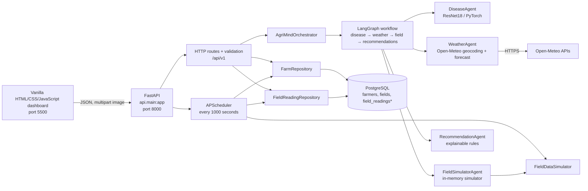

# AgriMind System Architecture

## What the system does today

AgriMind is a development-stage agricultural dashboard and FastAPI backend. The working flows are farmer/field browsing, display of the latest saved or simulated soil readings, optional current weather, tomato leaf image classification, and deterministic recommendations. Recommendations focus on cautious crop-health actions, soil-test-based fertilizer decisions, and reducing avoidable input/yield losses. The app does not prescribe fertilizer rates or calculate profit yet.

## Runtime architecture

`field_readings*` means the repository expects this table, but the checked-in initial SQL migration currently creates only `farmers` and `fields`.

## Main request flows

### Dashboard and field context

1. `frontend/app.js` calls `GET /api/v1/farmers`, then `GET /api/v1/farmers/{farmer_id}/fields` to populate the selectors.
2. Selecting a field calls `GET /api/v1/fields/{field_id}`. The API loads its farmer/field record and most recent stored sensor reading. If the user supplied a location, it also calls the weather adapter.
3. The browser refreshes selected-field detail every 15 seconds. This is polling, not a live sensor stream.

### Leaf diagnosis

1. The dashboard sends a multipart request to `POST /api/v1/fields/{field_id}/analyze` with an image, crop name, and optional location. `POST /api/v1/analyze` supports diagnosis without a field.
2. FastAPI checks the MIME type and limits the payload to 10 MiB, then passes the bytes to `AgriMindOrchestrator`.
3. The LangGraph workflow runs disease, weather, field, and recommendations in order. Weather is skipped when location is missing; field context is skipped when there is no field ID. Optional-agent failures produce warnings and a partial result.
4. `DiseaseAgent` applies evaluation transforms, lazily loads the disease ResNet18 checkpoint once per API process, runs inference, and returns the top class, probability, model version, and a low-confidence warning below 0.70.
5. `WeatherAgent` resolves the place with Open-Meteo geocoding, requests current conditions, and normalizes the response. It does not provide a multi-day forecast.
6. `RecommendationAgent` applies deterministic rules to the classifier result and field context, producing prioritized crop-health, fertilizer, and profitability actions with a reason and evidence basis.
7. The API validates the result using Pydantic response models. The browser displays the disease class, confidence, recommendations, and warnings.

The field node currently returns an in-memory simulated reading for the selected ID; it does not read the saved sensor history. The recommendation node explicitly treats simulated readings as unsuitable for fertilizer prescriptions. Its structured recommendations are returned in the diagnosis response and displayed with a reason and evidence basis.

### Simulated sensor history

At API startup, `api.main` starts an APScheduler background job. Every 1000 seconds the job fetches all fields, generates one simulated reading per field, and attempts to save each reading through `FieldReadingRepository`. The field detail route reads the newest saved row. The simulator generates bounded values and timestamps; it is development data, not a physical sensor integration.

## Code ownership by area

| Area | Responsibility |
|---|---|
| `frontend/` | Static dashboard, API calls, form upload, rendering, 15-second detail polling |
| `api/main.py` | FastAPI app, CORS, health endpoint, scheduler lifecycle |
| `api/routes.py` | HTTP endpoints, upload validation, repository and orchestrator calls |
| `api/schemas.py` | Pydantic request/response contracts |
| `orchestrator/` | Shared workflow state, LangGraph nodes, graph construction, agent coordination |
| `agents/disease_agent/` | ResNet18 training/inference code and API-facing disease adapter |
| `agents/weather_agent/` | Open-Meteo client and normalized weather result |
| `agents/field_agent/` | Field readings contract, simulator, scheduler, and PostgreSQL repositories |
| `database/` | PostgreSQL connection configuration and initial farmer/field schema/bootstrap |

## Data and dependencies

- PostgreSQL stores farmer and field metadata. `FieldReadingRepository` expects a `field_readings` table for sensor snapshots.
- The disease checkpoint is expected at `agents/disease_agent/models/resnet18_best.pth`; inference uses CUDA when available and otherwise CPU.
- Current weather is fetched from Open-Meteo at request time. There is no cache or weather persistence in this implementation.
- The frontend is static vanilla JavaScript and needs no Node build step. It expects the API at `http://127.0.0.1:8000/api/v1` by default.
- The API configures CORS for local dashboard/API origins. Authentication is not implemented.

## Current implementation gaps

These repository details matter when running or extending the system:

1. `database/001_farmers_and_fields.sql` does not create `field_readings`, although the reading repository queries it and the scheduler writes to it. The current database schema needs a migration before field readings can work reliably.
2. The field simulator's random walk does not receive the previous stored reading, so scheduled values are newly initialized rather than continuous per-field sensor histories.
3. The field agent runs during diagnosis but its output is not included in `AnalyzeResponse` and is not used to produce treatment guidance.
4. The current image model is trained for tomato only; the API rejects another crop name for image diagnosis.
5. The crop input is checked for “tomato,” but the uploaded photo is not independently verified as a tomato leaf. The classifier always predicts one of its five tomato classes; confidence alone cannot reliably detect an unrelated image.
6. Fertilizer recommendations are informational only: the app needs verified soil-lab results, crop stage, and a regional recommendation before it can calculate a product/rate. It deliberately does not derive rates from simulated readings.
7. Profitability recommendations are general loss-prevention advice. Local market prices, expected yield, and input/labor costs are not connected, so there is no profit estimate or ranking by return.
8. The workflow is sequential (disease → weather → field → recommendations), not parallel. Weather and field are optional, while disease inference is required.
9. The system is a local development application: no authentication, job queue, object storage, persisted analysis/audit history, production deployment configuration, or human review workflow is present.

## How to run locally

1. Configure `DATABASE_URL` in `.env`, start PostgreSQL, and bootstrap the initial farmer/field tables with `python database/bootstrap.py`.
2. Ensure the disease checkpoint exists at the path described above.
3. Start the API from the repository root: `python -m uvicorn api.main:app --reload`.
4. In another terminal, serve `frontend/` with `python -m http.server 5500` and open `http://127.0.0.1:5500`.

The bootstrap currently creates only farmer and field tables, so add the missing readings schema before relying on the sensor dashboard or scheduled readings.

## Next architecture steps

Keep the application as a modular monolith while the core contracts settle. The next practical steps are to add a `field_readings` migration, persist and expose field context consistently, record diagnosis runs and model versions, and add crop-care guidance behind explicit source and safety checks. Add authentication and upload storage before handling real farmer data. Split the inference worker or add a queue only when latency or load requires it.
